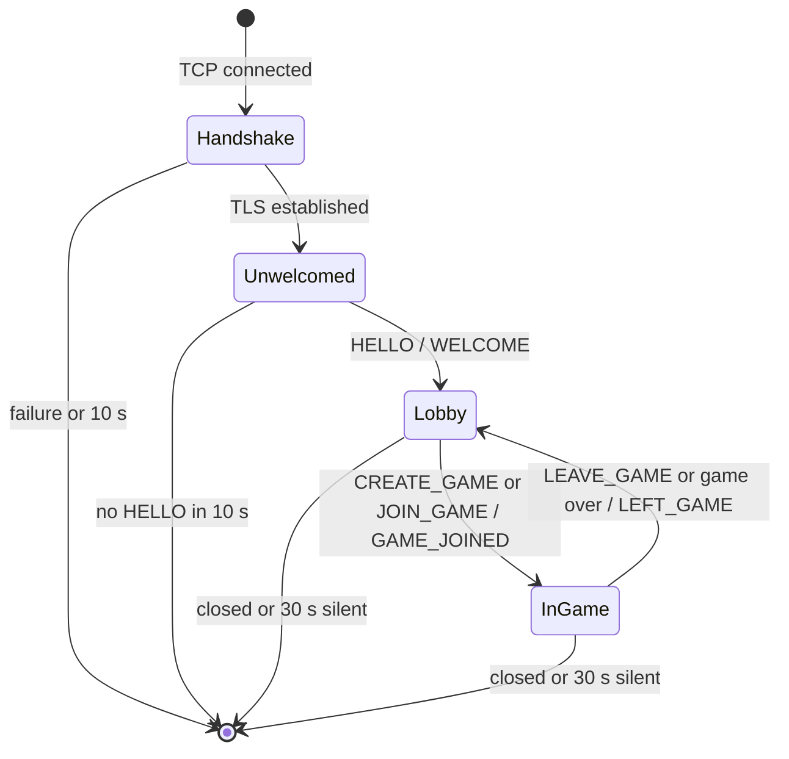

# Lobby (TCP)

The connection between a client and the master: TLS, framing, and the messages to list, create, join and
leave games. Conventions and types are defined in the [overview](index.md#2-conventions).

## 1. Connection

1. The client opens a TCP connection to the master, on port 4242 by default.
2. The client and the master run a TLS 1.3 handshake ([section 2](#2-tls)).
3. The client sends `HELLO` within 10 seconds. The master answers `WELCOME`.
4. The client sends requests; the master answers each of them and may send notifications.
5. The connection stays open while the client plays a game. Either side closes it with a TLS `close_notify`
   alert, then closes the TCP connection.



*A connection is welcomed with `HELLO`, then moves between the lobby and a game, and is closed on failure or
silence.*

| State | Messages accepted from the client |
|---|---|
| Unwelcomed | `HELLO`, `PING` |
| Lobby | `LIST_GAMES`, `CREATE_GAME`, `JOIN_GAME`, `PING` |
| In game | `LIST_GAMES`, `LEAVE_GAME`, `PING` |

Any other message is answered with `ERROR`: `HELLO_REQUIRED` before `HELLO`, `ALREADY_WELCOMED` for a second
`HELLO`, `ALREADY_IN_GAME` or `NOT_IN_GAME` otherwise.

## 2. TLS

- Only **TLS 1.3** ([RFC 8446](https://www.rfc-editor.org/rfc/rfc8446)) is allowed. A peer MUST refuse older
  versions.
- Cipher suites: the master MUST support `TLS_CHACHA20_POLY1305_SHA256` and `TLS_AES_128_GCM_SHA256`.
- Key exchange groups: `x25519` and `secp256r1`.
- The master presents an X.509 certificate holding an **ECDSA P-256** public key, signed with
  `ecdsa_secp256r1_sha256`. The certificate may be self-signed.
- No client certificate, no early data (0-RTT), no session resumption: the master does not issue session
  tickets.

### Key pinning

The client knows in advance the **fingerprint** of the master's public key: the SHA-256 hash of the DER
encoding of the `SubjectPublicKeyInfo` of the certificate, 32 bytes, written as 64 hexadecimal characters in
the client's configuration.

- The client MUST compute the fingerprint of the certificate the master presents, and abort the handshake if
  it differs from the pinned one. It reports the error to the player: the server is not the expected one.
- The client MUST NOT rely on certificate authorities, host names or validity dates: the pinned key replaces
  them.

The fingerprint of a certificate, or of a public key in PEM, can be computed with OpenSSL:

```sh
openssl x509 -in server.crt -pubkey -noout | openssl pkey -pubin -outform DER | sha256sum
openssl pkey -pubin -in server.pub -outform DER | sha256sum
```

## 3. Framing

TCP carries a stream of bytes with no boundaries. Inside TLS, each message is a **frame**:

| Offset | Field | Type | Description |
|---|---|---|---|
| 0 | Size | `u16` | Number of bytes that follow this field: the type and the payload. From 1 to 16382. |
| 2 | Type | `u8` | Message type |
| 3 | Payload | | Size − 1 bytes, layout given by the type |

- A frame is at most **16384 bytes**, size field included. A receiver MUST close the connection when it reads
  a size of 0 or above 16382, without reading the rest.
- Types `0x01`–`0x7F` are sent by the client, types `0x80`–`0xFF` by the master.

Example: `HELLO` with version 1 and the name `"Pavel"`:

```
00 09   size: 9 bytes follow
01      type: HELLO
00 01   version: 1
05 50 61 76 65 6C   name: "Pavel"
```

## 4. Requests, replies and notifications

- Every request from the client gets **exactly one reply**: its own reply message, or `ERROR`.
- The master answers requests **in the order it received them**. A client may send several requests without
  waiting, and match the replies in order.
- The master may also send **notifications** at any time, between replies: `LEFT_GAME` when the game ends or
  crashes. A notification is never a reply.

| Request | Reply |
|---|---|
| `HELLO` | `WELCOME` |
| `LIST_GAMES` | `GAME_LIST` |
| `CREATE_GAME` | `GAME_JOINED` |
| `JOIN_GAME` | `GAME_JOINED` |
| `LEAVE_GAME` | `LEFT_GAME` |
| `PING` | `PONG` |

## 5. Messages

### 5.1 Client to master

#### HELLO (`0x01`)

| | |
|---|---|
| **Direction** | Client → Master |
| **Sent when** | Once, first, right after the TLS handshake. |

| Offset | Field | Type | Description |
|---|---|---|---|
| 0 | Version | `u16` | Protocol version, 1 |
| 2 | Name | `str8` | Name of the player, 1 to 16 bytes |

**Receiver behaviour:** if the version is not supported, the master answers `ERROR (UNSUPPORTED_VERSION)`
and closes the connection. If the name is empty, too long or invalid, it answers `ERROR (INVALID_NAME)`.
Otherwise it gives the player an id and answers `WELCOME`. Names do not have to be unique.

#### LIST_GAMES (`0x02`)

| | |
|---|---|
| **Direction** | Client → Master |
| **Sent when** | The player opens or refreshes the list of games. |

No payload.

**Receiver behaviour:** the master answers `GAME_LIST`.

#### CREATE_GAME (`0x03`)

| | |
|---|---|
| **Direction** | Client → Master |
| **Sent when** | The player creates a game. |

| Offset | Field | Type | Description |
|---|---|---|---|
| 0 | Name | `str8` | Name of the game, 1 to 32 bytes |
| 1 + n | Max players | `u8` | 1 to 4 |

**Receiver behaviour:** the master starts a game instance ([instances](instances.md)), waits until it is
ready, adds the player to it and answers `GAME_JOINED`. Errors: `INVALID_NAME`, `MALFORMED` (max players out
of range), `SERVER_FULL` (no free game port), `GAME_START_FAILED` (the instance did not start within 10
seconds).

#### JOIN_GAME (`0x04`)

| | |
|---|---|
| **Direction** | Client → Master |
| **Sent when** | The player chooses a game in the list. |

| Offset | Field | Type | Description |
|---|---|---|---|
| 0 | Game id | `u32` | Id from `GAME_LIST` |

**Receiver behaviour:** the master adds the player to the game and answers `GAME_JOINED`. Errors:
`GAME_NOT_FOUND`, `GAME_FULL`. Players may join a game that has already started.

#### LEAVE_GAME (`0x05`)

| | |
|---|---|
| **Direction** | Client → Master |
| **Sent when** | The player quits the game, before closing the UDP session. |

No payload.

**Receiver behaviour:** the master removes the player from the game and answers `LEFT_GAME` with the reason
`REQUESTED`.

#### PING (`0x06`)

| | |
|---|---|
| **Direction** | Client → Master |
| **Sent when** | The client sent nothing for 10 seconds. |

No payload.

**Receiver behaviour:** the master answers `PONG`. A master closes a connection on which it received nothing
for 30 seconds.

### 5.2 Master to client

#### WELCOME (`0x81`)

| | |
|---|---|
| **Direction** | Master → Client |
| **Sent when** | Reply to `HELLO`. |

| Offset | Field | Type | Description |
|---|---|---|---|
| 0 | Player id | `u32` | Id of the player on this master, never 0 |

#### GAME_LIST (`0x82`)

| | |
|---|---|
| **Direction** | Master → Client |
| **Sent when** | Reply to `LIST_GAMES`. |

| Offset | Field | Type | Description |
|---|---|---|---|
| 0 | Count | `u16` | Number of games that follow, at most 256 |
| 2 | Games | | Count entries, sorted by game id |

Each entry:

| Offset | Field | Type | Description |
|---|---|---|---|
| 0 | Game id | `u32` | Never 0 |
| 4 | Name | `str8` | 1 to 32 bytes |
| 5 + n | Players | `u8` | Players currently in the game |
| 6 + n | Max players | `u8` | 1 to 4 |

**Receiver behaviour:** a client MUST check that the entries fit exactly in the frame, and treat the frame as
malformed otherwise.

#### GAME_JOINED (`0x83`)

| | |
|---|---|
| **Direction** | Master → Client |
| **Sent when** | Reply to `CREATE_GAME` or `JOIN_GAME`. |

| Offset | Field | Type | Description |
|---|---|---|---|
| 0 | Game id | `u32` | |
| 4 | UDP port | `u16` | Port of the game, on the same IP address as the master |
| 6 | Session id | `u32` | Identifies the player's session in the game, never 0 |
| 10 | Client key | `bytes[32]` | Key of the datagrams sent by the client |
| 42 | Server key | `bytes[32]` | Key of the datagrams sent by the game |

**Receiver behaviour:** the client opens the UDP session described in [Game (UDP)](game.md). The keys are
secret: a client MUST NOT write them to its logs.

#### LEFT_GAME (`0x84`)

| | |
|---|---|
| **Direction** | Master → Client |
| **Sent when** | Reply to `LEAVE_GAME`, or notification when the player is no longer in the game. |

| Offset | Field | Type | Description |
|---|---|---|---|
| 0 | Game id | `u32` | |
| 4 | Reason | `u8` | See below |

| Reason | Value | Meaning |
|---|---|---|
| `REQUESTED` | 0 | Reply to `LEAVE_GAME` |
| `GAME_OVER` | 1 | The game ended normally |
| `GAME_CRASHED` | 2 | The game process stopped unexpectedly |
| `TIMED_OUT` | 3 | The game received nothing from the client for 5 seconds |

**Receiver behaviour:** the client closes its UDP session and goes back to the lobby. For `GAME_CRASHED`, it
tells the player that the game stopped.

#### PONG (`0x85`)

| | |
|---|---|
| **Direction** | Master → Client |
| **Sent when** | Reply to `PING`. |

No payload.

#### ERROR (`0x86`)

| | |
|---|---|
| **Direction** | Master → Client |
| **Sent when** | Reply to a request that cannot be honoured. |

| Offset | Field | Type | Description |
|---|---|---|---|
| 0 | Request | `u8` | Type of the request that failed, 0 if it could not be read |
| 1 | Code | `u16` | See below |

| Code | Value | Meaning | Connection |
|---|---|---|---|
| `MALFORMED` | 1 | Invalid frame or field | Closed after the error |
| `UNKNOWN_MESSAGE` | 2 | Unknown message type | Kept |
| `UNSUPPORTED_VERSION` | 3 | Protocol version not supported | Closed after the error |
| `HELLO_REQUIRED` | 4 | Request sent before `HELLO` | Kept |
| `ALREADY_WELCOMED` | 5 | Second `HELLO` | Kept |
| `INVALID_NAME` | 6 | Empty, too long, or invalid name | Kept |
| `GAME_NOT_FOUND` | 7 | No game with this id | Kept |
| `GAME_FULL` | 8 | The game has its maximum number of players | Kept |
| `ALREADY_IN_GAME` | 9 | `CREATE_GAME` or `JOIN_GAME` while in a game | Kept |
| `NOT_IN_GAME` | 10 | `LEAVE_GAME` while not in a game | Kept |
| `SERVER_FULL` | 11 | No more games can be created | Kept |
| `GAME_START_FAILED` | 12 | The game process did not start | Kept |

**Receiver behaviour:** the client shows a message matching the code. Unknown codes are shown as a generic
error.

## 6. When the connection closes

- **The client closes it, or it times out:** the master removes the player from its game, if any. The game
  tells the other players ([game, `PLAYER_LEFT`](game.md#player_left-0x05)).
- **The master closes it:** the client closes its UDP session, if any, and tells the player that the
  connection to the server is lost.
